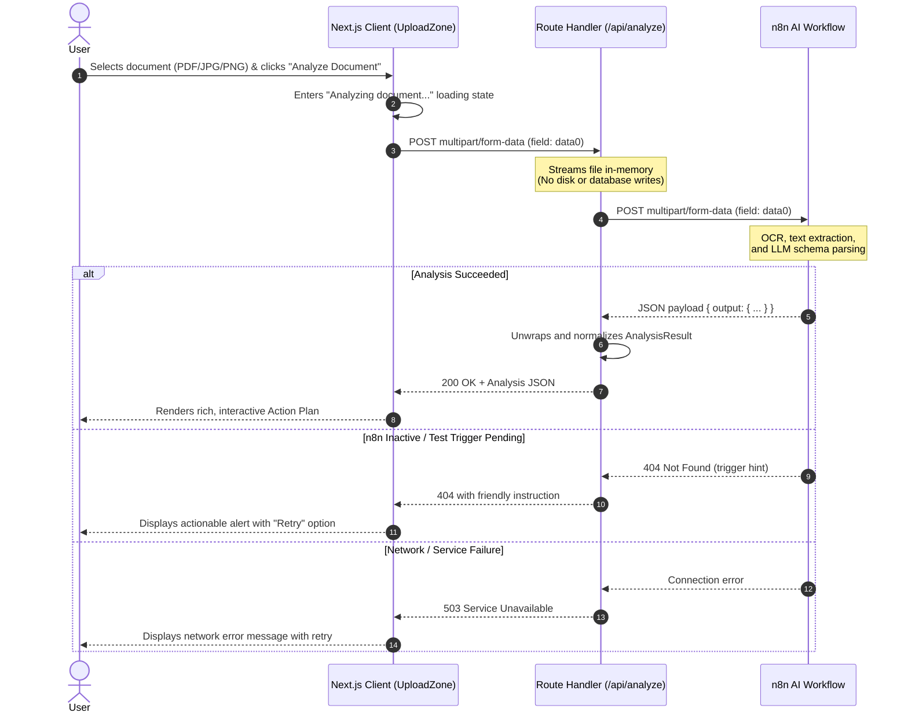

# Life Admin AI

<div align="center">

**Turn confusing documents into clear, prioritized action plans.**

[](https://nextjs.org/)
[](https://react.dev/)
[](https://www.typescriptlang.org/)
[](https://tailwindcss.com/)
[](https://n8n.io/)

</div>

---

## Overview

**Life Admin AI** is an independent, production-ready web application designed to eliminate paperwork anxiety. Complex documents — such as rental leases, medical bills, tax notices, insurance policies, and legal demands — are transformed into structured, plain-English action plans with immediate next steps and clear deadlines.

The application features a dark, modern interface built with Next.js App Router and Tailwind CSS, backed by an asynchronous n8n AI workflow engine for document intelligence.

---

## Key Features

- **Document Intelligence Engine**: Accepts PDF, JPG, and PNG documents up to 25 MB.
- **Drag-and-Drop Interface**: Real-time hover and drag-over feedback, file type detection, and formatted file size display.
- **Structured Action Extraction**:
  - **Document Classification**: Automatic detection of document type.
  - **Executive Summary**: Plain-English overview of core terms and intentions.
  - **Immediate Next Step**: A high-visibility, single prioritized action to take first.
  - **Critical Deadlines**: Timeline of dates and associated milestones.
  - **Required Actions**: Ordered checklist of specific tasks.
  - **Important Information**: Crucial terms, figures, amounts, and reference identifiers.
  - **Required Documents**: List of any supporting paperwork required.
  - **Critical Warnings**: High-visibility alert section highlighting penalties, expiration risks, and legal notices.
- **Dynamic Conditional Rendering**: Empty sections are automatically hidden to maintain a focused, clutter-free view.
- **Clipboard Export**: One-click summary and plan copying for personal task management.
- **Ephemeral & Private**: Files are streamed directly in-memory to the AI workflow. Nothing is permanently stored on disk or in a database.

---

## Architecture & Data Flow



### Expected n8n Response Schema

The backend workflow sends back the extracted fields inside an `output` object (or as root-level properties):

```json
{
  "output": {
    "document_type": "Residential Lease Agreement",
    "summary": "Standard one-year fixed-term lease agreement beginning November 1st.",
    "important_information": [
      "Monthly rent: $1,850 due on the 1st of each month",
      "Security deposit: $1,850 held in escrow",
      "Grace period: 5 days before a $50 late fee applies"
    ],
    "deadlines": [
      "October 25: Submit signed lease agreement and initial deposit",
      "November 1: Lease commencement date"
    ],
    "required_documents": [
      "Proof of renter's insurance ($100k liability)",
      "Government-issued photo ID"
    ],
    "required_actions": [
      "Review utility responsibility breakdown (Section 7)",
      "Sign and return page 12 of the agreement",
      "Set up recurring payment via tenant portal"
    ],
    "next_step": "Obtain renter's insurance policy certificate and sign the agreement by October 25.",
    "warnings": [
      "Unauthorized pets incur an immediate $250 penalty and notice to cure."
    ]
  }
}
```

---

## Tech Stack

| Layer | Technology |
| :--- | :--- |
| **Framework** | [Next.js](https://nextjs.org/) 16 (App Router, Turbopack) |
| **Runtime** | [React](https://react.dev/) 19 & Node.js |
| **Language** | [TypeScript](https://www.typescriptlang.org/) 5 |
| **Styling** | [Tailwind CSS](https://tailwindcss.com/) v4 |
| **Typography** | [Geist](https://vercel.com/font) (Sans & Mono) |
| **Workflow Engine** | [n8n](https://n8n.io/) (Self-hosted or Cloud webhook) |

---

## Project Structure

```text
life-admin-ai/
├── app/
│   ├── api/
│   │   └── analyze/
│   │       └── route.ts          # Server-side proxy & response unrolling for n8n
│   ├── globals.css               # Design system tokens, dark theme & ambient glow
│   ├── layout.tsx                # App root layout, SEO metadata & font setup
│   └── page.tsx                  # Main orchestration page (Hero, Upload, Results)
├── components/
│   ├── AnalysisResults.tsx       # Action plan dashboard with 8 dynamic sections
│   ├── Footer.tsx                # Minimal footer with disclaimers
│   ├── Header.tsx                # Sticky minimal navigation & branding
│   ├── HowItWorks.tsx            # 3-step process overview (Upload, Analyze, Act)
│   ├── PrivacyModal.tsx          # Accessible data privacy policy modal
│   ├── TrustDisclaimer.tsx       # Unobtrusive verification notice
│   └── UploadZone.tsx            # Drag-and-drop upload card with state handling
├── public/                       # Static SVGs and icons
├── types/
│   └── analysis.ts               # TypeScript interface for analysis results
├── .env.example                  # Environment variable template
├── .gitignore                    # Git ignore specifications
├── package.json                  # Dependencies and scripts
└── tsconfig.json                 # TypeScript compiler configuration
```

---

## Getting Started

### Prerequisites

- **Node.js**: v18.18 or higher (v20+ recommended)
- **npm**, **pnpm**, or **yarn**
- An active **n8n** workflow with a Webhook node configured to receive multipart/form-data.

### 1. Clone the Repository

```bash
git clone https://github.com/your-username/life-admin-ai.git
cd life-admin-ai
```

### 2. Install Dependencies

```bash
npm install
```

### 3. Configure Environment Variables

Copy the example environment file:

```bash
cp .env.example .env.local
```

Edit `.env.local` to point to your n8n webhook:

```env
# For local n8n testing:
N8N_WEBHOOK_URL=http://localhost:5678/webhook-test/your-webhook-id

# For production n8n deployment:
# N8N_WEBHOOK_URL=https://n8n.yourdomain.com/webhook/your-production-webhook-id
```

### 4. Run the Development Server

```bash
npm run dev
```

Open [http://localhost:3000](http://localhost:3000) in your browser.

### 5. Build for Production

```bash
npm run build
npm run start
```

---

## Usage

1. Open the application at `http://localhost:3000`.
2. Drag and drop a document (PDF, JPG, or PNG) onto the upload card, or click **Browse files**.
3. Verify the file name and size in the preview.
4. Click **Analyze Document**.
   - The app streams the file to your configured n8n webhook.
   - If running an n8n test webhook, ensure you have clicked **"Execute workflow"** in the n8n canvas.
5. Review the extracted **Document Type**, **Executive Summary**, **Immediate Next Step**, **Required Actions**, **Deadlines**, **Important Information**, and **Warnings**.
6. Use **Copy Plan** to copy the formatted text to your clipboard, or click **Analyze another** to process a new document.

---

## Privacy & Security

- **Ephemeral Processing**: Uploaded documents are streamed in memory directly through the Next.js API route to the n8n webhook. Files are **not stored** on the server's filesystem, database, or third-party buckets.
- **Protected Endpoints**: The Next.js API route (`/api/analyze`) acts as a secure server-to-server proxy. The n8n webhook URL and credentials remain on the server and are never exposed in client-side JavaScript bundles.
- **CORS Protection**: Because document forwarding is performed server-side, browser cross-origin resource sharing restrictions between client and webhook servers are eliminated.
- **Verification Notice**: AI-assisted document parsing is informational. Critical financial, medical, and legal dates or obligations should always be verified against the official issuing source.

---

## License

This project is licensed under the MIT License. See [LICENSE](LICENSE) for details.
